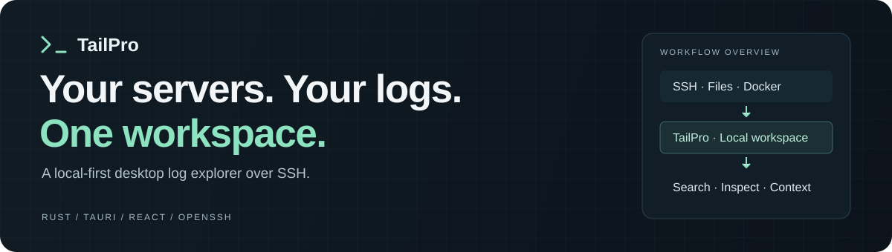

<p align="center"></p>

TailPro is a local desktop workspace for exploring remote logs over SSH. Built with Rust, Tauri and React. [Tiếng Việt](README.vi.md).

[Download releases](https://github.com/HuuTu2004/tailpro/releases) · [Build status](https://github.com/HuuTu2004/tailpro/actions) · [Validation evidence](docs/process/current-status.md)

Version 0.1.0 is a development preview. Native packages are built on each target OS; signing and runtime coverage are described below.

## Features

- Saved SSH connections, config aliases, private-key selection, optional jump hosts, strict host-key verification and per-session dynamic-config consent.
- An **Open logs** window with **Found sources**, **Browse folders** and **Enter path**. Select several sources, see access/scan coverage, then open them.
- Remembered source choices and scan locations. Optionally restore previous readers after you explicitly reconnect; credentials and log contents are not saved in settings.
- File, Docker and systemd Journal readers with source health, pause/resume, source tabs and combined views. Maximum three hosts and eight readers per workspace.
- Three viewer controls: **Columns**, **Time** (date/time range) and **Status** (log level). Search, event details and redacted CSV/NDJSON export use the same backend query.
- Optional scoped MCP evidence tools and optional local Ollama / HTTPS BYOK explanations. Sharing requires grants or approval in the app.

Discovery reads bounded metadata in the displayed locations. Add directories to expand the scope; it does not promise to find every log on a server. Compressed archives are shown as unsupported. Retained logs are held in memory, with visible retention/continuity gaps.

## Install

| System | Download | Prerequisites |
| --- | --- | --- |
| Windows x64 | NSIS setup `.exe` | Windows 10/11, WebView2 and Windows OpenSSH Client |
| macOS Apple Silicon | `aarch64.dmg` | macOS 12+ and system OpenSSH |
| macOS Intel | `x64.dmg` | macOS 12+ and system OpenSSH |
| Linux x64 | `.deb` or `.AppImage` | Ubuntu 24.04 or compatible GTK 3 / WebKitGTK 4.1 desktop; OpenSSH; AppImage may require FUSE 2 |

Install the package for your CPU architecture. MCP adapters are separate platform ZIP files on the same release; extract one and use the absolute path to `tailpro-mcp` in the enrollment configuration shown by Settings.

Packages are not signed with a paid Apple Developer or Windows signing certificate. macOS packages use ad-hoc signing and are not notarized; Gatekeeper may block opening. Verify the release checksums and use your OS's explicit approval flow for downloaded apps you trust. Windows may display SmartScreen. There is no automatic updater.

**Windows authentication:** readers use separate Windows OpenSSH processes because the system client does not support ControlMaster. Use key/SSH-agent authentication; add encrypted keys to the Windows OpenSSH agent before connecting. Password/keyboard-interactive sessions currently require macOS or Linux. This restriction is surfaced as an actionable connection error.

**Remote servers:** Linux or macOS with a POSIX shell and Python 3. Docker requires a reachable Docker daemon and CLI permissions. Journal requires Linux/systemd and readable Journal access. Remote Windows log readers are not supported. Tailscale works through normal SSH reachability; TailPro does not manage the VPN.

## Start reading logs

1. Open **Connections**, enter a host or SSH alias, choose authentication, then **Connect**. Verify any new host fingerprint against a trusted source. No automatic trust bypass.
2. On the first connection, **Open logs** appears. Choose found sources, browse folders, or enter an absolute file path. Click **Open selected**.
3. Use Columns, Time and Status to inspect events. Source health and scan coverage show incomplete access or gaps.
4. Reopen remembered logs from the host tree. After restarting TailPro, click a saved host to reconnect. Enable **Restore previous readers after I reconnect** in the picker if desired.
5. Preview redacted exports or create an explicit MCP grant in Settings.

The + beside a host opens the log picker. Saved profiles can be edited through the Connections form. Settings and source history are local; disconnecting does not forget the server.

| Shortcut | Action |
| --- | --- |
| Ctrl+F / Cmd+F | Focus search |
| Space in the log table | Pause / resume |
| Enter on a row | Open details |
| Escape | Close the active popup or editor |

## Run from source

Install [Tauri prerequisites](https://v2.tauri.app/start/prerequisites/) for your OS, Rust 1.97.1 (pinned in `rust-toolchain.toml`), Node.js 22.12+ and npm. Then:

```bash
npm ci
npm run contracts
npm run tauri dev
```

`npm run dev` serves only frontend assets; the native backend is required. There is no mock backend or bundled production data.

Build native packages on the target OS:

```bash
npm run tauri build -- --locked
cargo build -p tailpro-mcp --release --locked
```

Bundles are in `target/release/bundle/`. The [release workflow](.github/workflows/release.yml) builds Windows x64, Linux x64, macOS ARM64 and macOS x64, then creates a release tag and publishes only after every build succeeds. Release assets include SHA-256 checksums.

## Development and validation

See [CONTRIBUTING.md](CONTRIBUTING.md), [architecture](docs/system-design/architecture.md), [connection/source design](docs/system-design/connection-and-source-picker.md) and [current status](docs/process/current-status.md). Rust DTOs generate the TypeScript contract. Dependencies follow desktop → app-core → log-core; the small platform crate owns private local storage permissions.

Checks use scoped builds, Clippy, typecheck and manual acceptance, following the repository policy. Building a package does not certify all runtime scenarios. Live Linux-client → macOS-server Spring Boot reading over Tailscale has acceptance evidence; Windows/macOS desktop runtime coverage and sustained-load/other historical gates remain tracked in the status report.

MIT license. IBM Plex fonts retain their bundled license in `src/shared/ui/fonts/`.
