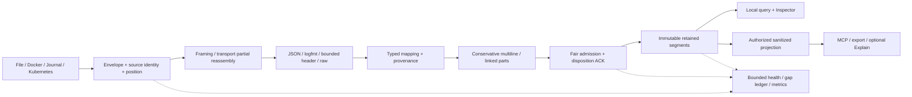

# Phase 6 — Universal log ingestion, continuity và tối ưu có số đo

**Trạng thái: đã triển khai core 6.2–6.8, hardening/source simulation 6.9, baseline và tối ưu có số đo 6.10, scoped Kubernetes 6.12; 6.11 Deferred theo decision RAM mode. Build/manual evidence xem acceptance; Gate A/B/C chưa được chứng nhận runtime đầy đủ.** Lập ngày20/11/2026, cập nhật25/11/2026, Asia/Bangkok. [Schema v1](../system-design/ingestion-schema.md) và [acceptance6.1](../process/phase-06-acceptance.md) phân biệt foundations với runtime legacy. Số thứ tự6 không bắt buộc chờ phát hành phase5 mới bắt đầu; không thay các runtime gates chưa đạt của phase1–4.

**Kết quả cần đạt:** Một pipeline dùng chung đọc được log của Go/Rust/Node/Java/Python/PHP, Redis/Kafka/Nginx qua các nguồn được hỗ trợ; thêm format bằng cấu hình nhỏ; luôn giữ bằng chứng về nội dung, cách suy luận và khoảng thiếu. Tối ưu tổng chi phí đọc → parse → giữ → query → UI/MCP trên cùng workload.

**Cơ sở:** [Research nguồn chính thức](../system-design/universal-log-ingestion-research.md), [architecture](../system-design/architecture.md), [contracts](../system-design/contracts.md), [current status](../process/current-status.md). Schema6.1 đã được chốt. Thiết kế bên dưới là mục tiêu; [acceptance](../process/phase-06-acceptance.md) và [parser config v1](../system-design/parser-configuration.md) ghi chính xác phần đã triển khai, phần mô phỏng và capability còn Unsupported.

## 1. Quyết định kiến trúc

1. Tách **source adapter**, **transport envelope**, **payload decoder**, **field mapping**, **multiline** và **query projection**. Không có parser Go/Java/Kafka riêng; vẫn cần xử lý những protocol thực sự khác nhau như Docker timestamp, Journal entry và Kubernetes API.
2. JSON, logfmt, text có header và raw là bốn đường xử lý hữu ích, không phải định lý bao phủ mọi log. Giữ đường mở rộng bằng profile khai báo; binary/protobuf/cloud backend ngoài capability phải hiện Unsupported.
3. Cam kết **không mất dòng vì không nhận diện format**, kèm phạm vi retention/caps; mọi cắt nội dung, từ chối admission, reconnect và không biết continuity đều hiện rõ. Không công bố zero-drop end-to-end hoặc exactly-once cho kiến trúc SSH/RAM hiện tại.
4. Dùng lại engine single writer, fair queues, immutable segments, CPU permits và policy hiện có. Chưa thêm database, ingest server, remote daemon, plugin runtime hoặc full-text index.
5. Parser không cần AI. AI/MCP dùng cùng dữ liệu đã normalize và sanitize, nhận quality/coverage như UI. “Tracking sâu” là truy vết bằng chứng và correlation khi có ID, không tự sinh trace còn thiếu.



## 2. Khoảng thiếu đã xác nhận trong repo

Bảng này là snapshot baseline trước implementation6.2–6.12, không phải mô tả code hiện tại hoặc runtime certification; trạng thái sau implementation xem acceptance. Các file đang có thay đổi của công việc khác được giữ nguyên trong đợt lập plan.

| Vùng | Đã có | Thiếu cần xử lý | Mục |
| --- | --- | --- | --- |
| `log-core/src/parse/normalize.rs` | Selective JSON, ANSI, raw fallback | `ts/lvl`, timestamp số, numeric level, logfmt quotes; nested leaf có thể lấn root; malformed JSON bỏ field extraction | 6.3–6.5 |
| `log-core/src/parse/framing.rs` | Raw-byte offset, bounded frame | Truncates phần vượt cap; chưa giữ đầy đủ fragment/raw bytes | 6.2 |
| `log-core/src/parse/multiline.rs` | Go/Python/Node, idle50ms/max100ms, late2s, cap200 lines | Java/PHP/Rust, header boundaries, interleaving, explainable grouping | 6.6 |
| `log-core/src/model/mod.rs` | Event/observed time/quality/physical IDs | `raw` là UTF-8 lossy String; namespace timestamp/severity/field provenance còn thiếu | 6.1–6.2 |
| `log-core/src/query/mod.rs` | Literal tìm `message OR raw`, bounded page/deadline | Chưa arbitrary attributes; chưa baseline chi phí `.contains` so với Finder | 6.8, 6.10 |
| `app-core/adapters/sources/reader.rs` | File offsets, Docker timestamps, contiguous ACK, replay flag | Docker ghi đè app event time; CLI stderr/TTY/recovery còn cần kiểm chứng thật | 6.3, 6.9 |
| `app-core/adapters/sources/journal*` | Journal JSON/cursor, priority fallback, vacuum gap | Thay binary/repeated MESSAGE bằng placeholder; envelope time ghi đè app time; metadata chọn lọc còn thiếu | 6.2–6.3, 6.9 |
| `app-core/workers/mod.rs` | DRR, permits, admission ACK; normalize ≥4KiB qua blocking job | Nhỏ hơn4KiB vẫn xử lý inline; reader await ACK từng event, cần đo trước batch | 6.10 |
| Application/UI/MCP | Source loss metadata, sanitized query/output, lazy JSON Inspector, eight tools | Chưa đầy đủ parse provenance/coverage/query counters xuyên consumer | 6.8, 6.12 |
| Adapter registry | Docker/file/Journal qua SSH | Chưa Kubernetes adapter; syslog socket không đồng nghĩa Journal | 6.9, 6.12 |

## 3. Capability và phạm vi hỗ trợ

| Nguồn | Hướng đọc | Continuity có thể biết | Phạm vi công bố |
| --- | --- | --- | --- |
| Regular text file | Descriptor + byte offset + device/inode/guard/generation | Tốt trong cùng file còn đọc được; rotation/truncate cần evidence | Không hỗ trợ FIFO, socket, file đã bị xóa trước khi đọc; copytruncate có cửa sổ mất upstream |
| Docker/Compose | `docker logs --timestamps --follow`, typed container ID | Timestamp overlap chỉ hỗ trợ replay; không có durable event offset | Kiểm tra logging driver/cache, TTY, permissions; Compose recreate cần generation mới |
| Journal | `journalctl` JSON theo unit, opaque cursor | Xác minh cursor thực tồn tại; vacuum/restricted access là gap/unknown | Chỉ các entries user đọc được; syslog chỉ được bao phủ nếu đã được route vào journal/file |
| Kubernetes | Context + namespace + Pod UID + container + instance | Timestamp overlap, restart/recreate metadata; không có complete-history cursor | Adapter riêng, scoped read; không hứa đọc mọi rotated file hay mọi instance lịch sử |
| Syslog trực tiếp / OTLP / cloud log API / Kafka topic | Chưa trong baseline này | Chưa có delivery/cursor contract | Backlog riêng; Kafka broker **log file** khác Kafka **topic consumer** |

Kubernetes không được coi là “chỉ thay `docker` bằng `kubectl`”. Shell-out `kubectl` có kubeconfig credential plugins; cần explicit context/trust handling. Không dùng `kubectl exec`, `attach`, `port-forward`, cluster-wide discovery hay mount node filesystem để lách quyền.

## 4. Mô hình event và sự thật về thời gian

### 4.1 — Dữ liệu nội bộ gọn, DTO chỉ tạo khi cần

Schema ngữ nghĩa đã chốt ở [6.1](../system-design/ingestion-schema.md); layout retained Event sẽ migrate ở6.2–6.3 và chỉ tối ưu sau số đo6.10.

| Nhóm | Dữ liệu đề xuất | Quy tắc |
| --- | --- | --- |
| Identity | session/source ID, source generation, stream, ingest sequence, physical/fragment IDs | Không dùng timestamp hoặc hash message làm event ID; intern metadata của source theo generation |
| Raw | Original payload bytes/spans, terminator, encoding/fragment metadata; envelope metadata riêng | Một bản payload; display text/ANSI-free overlays chỉ giữ khi cần và charge bytes |
| Time | `event_time`, `transport_time`, `observed_time`, original literal, precision, timezone source | Không ghi đè lẫn nhau; wire ns/i64 lớn dùng string, không JS Number |
| Severity | normalized level, original text/value, numeric namespace, origin/confidence | Unknown hợp lệ; fatal giữ original dù UI hiện tại gộp Error |
| Body | Message span hoặc decoded string khi có escaping; parse status/rule revision | Chỉ loại header khỏi Message khi offset đã xác nhận; raw luôn giữ header |
| Attributes | Selected typed fields/spans; phần còn lại Inspector đọc lazy từ raw | Không giữ JSON tree/HashMap cho mọi row; root và nested path có namespace |
| Correlation | trace/span/parent span, request/correlation ID, service/container/pod identity, explicit duration | Validate kiểu/đơn vị; generic request ID không giả thành W3C trace ID |
| Evidence | decoder/profile revision, bounded reason codes, extraction spans, group links | Không cấp confidence số giả; dùng `explicit`, `profile`, `heuristic`, `unknown` |
| Quality | malformed, encoding loss, fragment/incomplete group, uncertain/replay/gap refs | Tách parse quality, upstream coverage, retention và redaction; không gộp vào một “healthy” |

OpenTelemetry phân biệt thời điểm sự kiện và thời điểm thu thập, cùng severity/trace fields. Thiết kế mượn ngữ nghĩa này, chưa thêm OTLP receiver hay cả OTel SDK vào hot path. [Nguồn](https://opentelemetry.io/docs/specs/otel/logs/data-model/)

### 4.2 — Thời gian và level không được đoán bừa

- Display time: app event time hợp lệ → transport time → observed time; UI cho biết đang dùng loại nào. Cursor Docker/Journal luôn từ transport metadata, không từ app timestamp. Sắp xếp mặc định theo ingest sequence ổn định; event-time view ghi rõ late arrival/clock skew, không giả causal order.
- Timestamp số: explicit unit/profile ưu tiên; heuristic magnitude chỉ là ứng viên. Giữ nguyên decimal literal; parse integer + fractional bằng arithmetic có kiểm tra overflow, không qua `f64` rồi nhân nanosecond. Giá trị mơ hồ giữ Unknown thay vì đoán theo `ts`.
- Timestamp thiếu timezone lấy timezone source đã cấu hình; client Asia/Bangkok không tự trở thành timezone server. Thiếu year/DST ambiguity phải ghi uncertainty hoặc để chưa normalize. Không sửa giờ theo “thời gian nhận” mà xóa timestamp gốc.
- Numeric severity phải có namespace. Pino dùng10/20/30/40/50/60, còn syslog và OTel có thang khác. Auto-hint không chứng minh đúng namespace; explicit profile được ưu tiên. [Pino API](https://raw.githubusercontent.com/pinojs/pino/main/docs/api.md)
- Các alias chữ: TRACE/DEBUG/INFO/NOTICE/WARN/WARNING/ERROR/FATAL/PANIC/CRIT/CRITICAL/SEVERE được normalize theo bảng duy nhất có version; từ trong URL, JSON string, câu “no error” không thành header level. `stderr` là stream, không chứng minh Error.

## 5. Decoder dùng chung, profile nhỏ

### 5.1 — Routing và fast path

Envelope decode luôn chạy trước payload detection. Mỗi physical record được kiểm tra, không khóa source vào JSON mãi sau vài dòng đầu. Source profile chỉ thay thứ tự probe; format đổi giữa chừng vẫn fallback.

Thứ tự mặc định: cheap shape checks → JSON nếu có cấu trúc phù hợp → logfmt nếu có key/value grammar → bounded header scanner → raw. Override rule đã được user chọn chạy trước đường mặc định trong scope đó. Chỉ chạy decoder có candidate evidence; không chạy nhiều regex toàn dòng cho từng format.

JSON phải validate hết record trong depth/byte budget trước khi nhận extraction; không dừng sau `level/msg` và bỏ đuôi lỗi. Không tự unwrap nhiều lớp JSON vô hạn: một lớp envelope đã định nghĩa, nested JSON chỉ opt-in có depth/byte cap. JSON scalar/array vẫn là body hợp lệ nhưng không tự fan-out thành nhiều sự kiện. Pretty-printed JSON cần profile structural multiline riêng có state quote/escape/depth/bytes/age; chưa chọn profile thì giữ từng raw part, không nối mọi dòng thiếu timestamp.

### 5.2 — Mapping chính xác, không phụ thuộc thứ tự key

| Trường | Alias mặc định | Điều kiện |
| --- | --- | --- |
| Time | `@timestamp`, `timestamp`, `time`, `ts` | Root path có type/unit hợp lệ hoặc profile chỉ rõ; priority cố định, conflict giữ evidence |
| Level | `level`, `lvl`, `severity`, `severity_text` | Chuỗi hoặc numeric namespace rõ; `severity_number` thuộc profile riêng |
| Message | `message`, `msg`; sau đó `error.message`/`err.message` khi thiếu message | `err` object giữ attributes; không ép object thành text và làm mất `msg` |
| Trace/span | Root `trace_id/traceId`, `span_id/spanId`, explicit nested paths, `traceparent` hợp lệ | Không recursive-match leaf bất kỳ; conflict giữ original |
| Duration/status | Explicit `duration_ms`, profile unit khác; `http.response.status_code`/profile HTTP field | Không suy mọi `status=500` là HTTP; không dùng duration âm/NaN/∞ |

Root `level=info` và `payload.level=error` phải cho cùng kết quả dù đổi thứ tự JSON key. Duplicate keys hoặc alias conflict giữ raw + conflict flag; chọn theo policy đã version, không phụ thuộc traversal order. User fields không ghi đè trusted host/Pod/source identity.

Logfmt cần state machine xử lý quoted spaces, escaped quote/backslash, empty value, duplicate key và malformed suffix. Profile chỉ rõ dialect; malformed giữ raw, chỉ công nhận extraction nếu record hợp lệ theo policy. Không dùng `split_whitespace()` cho `msg="slow request"`. [Reference decoder](https://raw.githubusercontent.com/go-logfmt/logfmt/main/decode.go)

### 5.3 — Scanner timestamp có giới hạn và suy luận có ngữ cảnh

80 ký tự chỉ dùng như fast hint. Đề xuất prefix budget256 **bytes** có boundary an toàn; quá prefix thì không tìm thấy field cũng không mất raw. JSON/logfmt đi đường structured riêng, không chịu giới hạn prefix này.

| Nhóm thời gian | Ví dụ hoặc biến thể | Điều kiện |
| --- | --- | --- |
| RFC3339/ISO có offset | `2026-11-20T17:00:01.123Z`, `+07:00` | Fraction1–9 digits, validate calendar |
| ISO/SQL space | `2026-11-20 17:00:01,234` hoặc `.234` | Missing timezone có policy rõ |
| Slash date | `2026/11/20 17:00:01` | Tránh lẫn dd/mm và mm/dd |
| Apache/HTTP access | `[20/Nov/2026:17:00:01 +0700]` | Bracket/locale/token boundaries |
| Day month year | `20 Nov 2026 17:00:01.123` | English month; prefix PID/role chỉ là context hint |
| Syslog legacy | `Nov 20 17:00:01` | Missing year/timezone: không tự khẳng định chính xác |
| Time-only | `17:00:01.123` | Không tạo epoch nếu chưa có date context tin cậy |
| Unix epoch | seconds/ms/us/ns, có thể decimal | Explicit unit hoặc constrained profile; mơ hồ giữ nguyên |

Level token chỉ được tìm ở header span/cấu trúc phù hợp. Redis dùng `.` debug, `-` verbose, `*` notice và `#` warning; chỉ map khi khớp đủ Redis-like header/profile, không áp dụng ký hiệu toàn cục. [Redis source](https://github.com/redis/redis/blob/unstable/src/server.c)

Nginx combined/common access là **profile cấu trúc access log** dùng chung nhiều server: status được extract đúng sau quoted request, không dò mọi `5xx` trong80 ký tự. Profile access có thể scan record trong byte budget nếu request dài, khác universal header prefix scanner. `log_format` tùy biến có thể cần user rule. [Nginx log format](https://nginx.org/en/docs/http/ngx_http_log_module.html)

Syslog RFC5424/legacy header qua **file đã chọn** có thể là profile payload của6.5, giữ PRI/facility/severity/time theo schema; điều này không tạo direct syslog socket adapter. Profile là dữ liệu cấu hình cho scanner/mapper chung, không module riêng theo Redis/Nginx/Kafka.

HTTP status tạo `http.response.status_code` và `derived_http_error`; giữ tách log severity explicit. Nếu UI cho phép suy Warn/Error từ4xx/5xx, phải là tùy chọn hiển thị có origin rõ. Không bắt một response502 phải được logger ghi mức Error.

### 5.4 — Multiline là state machine có bằng chứng

Hai bước riêng: **transport partial reassembly** (ví dụ CRI nếu đọc CRI trực tiếp) → **application multiline**. Không áp dụng parser CRI cho output `kubectl logs` đã được API xử lý; tránh nối hai lần.

Key assembly ít nhất là `(source identity, generation, stream, container instance)`; thread/request ID có thể làm key bổ sung khi explicit và trong cap. Nếu process cùng stream interleave mà không có ID, không thể tái tạo chắc chắn; giữ thành linked/uncertain parts thay vì nối bừa.

Rule có `start`, `continue`, `boundary`, `idle flush`, `max age`, `max lines`, `max bytes`. Header có timestamp/structured record mới chặn continuation; thiếu timestamp **không đủ** để nối vào dòng trước. Hỗ trợ pattern families stack frame/exception/cause/suppressed/Go goroutine/Python chain/Rust backtrace; những token nhỏ là profile data cùng một assembler.

Giữ khởi điểm idle50ms, max100ms, late link2s,200 lines và byte cap hiện hành đến khi có số đo. Late parts tham chiếu group immutable; không sửa row đã publish. Hết cap phát part mới/quality flag, không bỏ suffix. Group eviction giữ được parts còn retained và hiện thiếu head/tail. Stop/reconnect/generation change có flush/partial disposition rõ, không ACK phần chưa giữ được.

### 5.5 — User rule ngắn, bounded và dễ kiểm tra

`.tailpro.toml` nằm ở project local do user chọn; không tự đọc config remote hoặc mở repository từ code hint. Có thể import thủ công vào source settings. Không execute scripts/interpolation/plugins từ config.

```toml
version = 1

[[parse.rules]]
id = "team-text"
source = "payments"
pattern = '^(?P<time>\S+)\s+(?P<level>INFO|WARN|ERROR)\s+(?P<msg>.*)$'
time_format = "rfc3339"
```

Một dòng `pattern` đủ mô tả phần extraction; file vẫn cần version/scope. Các option nâng cao như `time_unit`, `timezone`, `level_namespace`, nested paths hoặc multiline states tách riêng khi cần.

Đề xuất khởi điểm: config≤64KiB,≤16 rules toàn workspace/≤4 candidate rules một source, pattern≤2KiB, tổng compiled footprint có ceiling4MiB **trong** existing control budget. Compile một lần lúc import/change; syntax lỗi giữ config cũ còn hợp lệ và báo lỗi rõ, không tự mất nguồn. Rust regex không hỗ trợ lookaround/backreference; giới hạn pattern, compiled program và input, dùng một capture search mỗi candidate thay vì `captures_iter` trên log vô hạn. [Regex guarantees và giới hạn](https://docs.rs/regex/latest/regex/)

Preview cho biết matched spans, normalized fields, conflicts và sample không match; sample do user chủ động chọn, không persist raw vào diagnostics. Rule revision mới flush/fence assembler; record cũ giữ semantics cũ. Bật/tắt rule từng source có rollback; preview không tự start source.

Ví dụ cú pháp **đề xuất**, chưa phải config đang được app hỗ trợ; schema chính thức chốt ở6.7. Phần regex vẫn là một dòng có named groups:

```toml
version = 1
[[parse.rules]]
id = "team-header"
source = "api"
mode = "override"
time_format = "rfc3339"
pattern = '^(?P<time>\S+)\s+(?P<level>TRACE|DEBUG|INFO|WARN|ERROR|FATAL)\s+(?P<msg>.*)$'
```

Chỉ load `.tailpro.toml` từ đường dẫn local/project do user chủ động chọn; remote config cần capability đọc config hiện hành. Không tự scan repository/host hoặc execute interpolation/includes. Rule đơn dòng không diễn tả mọi multiline; phần multiline dùng state profile tương ứng.

## 6. Không mất vì parser và continuity trung thực

### 6.1 — Ranh giới cam kết

| Trường hợp | Hành vi bắt buộc |
| --- | --- |
| Unknown/malformed format trong record bounds | Emit raw event + parse status; admission vẫn theo budget |
| Invalid UTF-8 | Giữ original bytes nếu đã vào chế độ6.2; display replacement/hex có flag; không gọi lossy String là raw nguyên bản |
| Oversize record | Fragment có offsets/sequence và completeness; nếu cap admission không cho giữ hết thì gap/lost-byte evidence, không “full raw” giả |
| Journal binary/repeated MESSAGE | Preserve bounded typed representation và origin; quá cap hiện unsupported/truncated chứ không placeholder rồi claim nội dung đầy đủ |
| Retention eviction | Count + retained range/epoch; khác ingest discard; search chỉ nói về retained coverage |
| Input pressure | Backpressure có giới hạn/replay khi khả thi; hết khả năng → explicit disposition/gap; không queue vô hạn |
| Disconnect/rotation/vacuum | Cursor/replay evidence + continuity unknown hoặc known gap; không đoán số dòng upstream đã mất |
| Crash/restart ở RAM-only | Session trước mất buffer/checkpoints; không hứa durability |

“Không mất dòng vì parser” chỉ được công bố sau6.2/6.4–6.6 và gate6.12 cho phạm vi đã kiểm chứng. Hiện tại framer còn truncate nên chỉ có bounded fallback. Fragmentation không tạo storage vô hạn: suffix có thể bị retention evict, phải hiện incomplete.

### 6.2 — ACK, loss ledger và đối soát

Mỗi đơn vị admission có đúng một terminal disposition: retained representation hoặc explicit gap/rejection; in-flight có giới hạn. Đơn vị này thường là physical record hoàn chỉnh; với oversize là bounded fragment có raw range/record lineage. Multiline nhiều physical records → một event, oversize một physical record → nhiều fragments: **không** dùng `received_lines == accepted_events` làm invariant.

Đối soát theo source generation và watermark:

```text
admission_units_total = retained_disposition_total + gap_disposition_total + inflight_units
payload_bytes_observed = represented_payload_bytes + explicit_unrepresented_bytes + inflight_payload_bytes
```

`represented_payload_bytes` là cumulative tại admission, khác resident bytes sau eviction; envelope và terminator được định nghĩa riêng, không đếm double khi group/replay. Physical-line counter chỉ tăng khi thấy delimiter/end theo protocol; fragmentation không làm tăng line count giả. Một dòng chưa có LF phải phát fragment khi đầy, không giữ cả dòng hoặc pending list đến vô hạn. Số loss upstream chưa biết là `unknown`, không điền0.

Admission unit phải atomic: toàn bộ bounded unit được đại diện hoặc toàn bộ unit nhận gap disposition. Một logical record có nhiều units có thể có trạng thái `complete`, `partial_with_gap` hoặc `fully_gapped`; summary này không được cộng vào counters đơn vị lần nữa. Nếu implementation cho phép partial admission bên trong unit, phải chia thành các byte ranges không overlap trước khi đối soát. Transport positions/bytes chỉ tính từ boundary reader thực sự quan sát, không suy toàn bộ bytes mà app upstream từng ghi.

Oversize structured record chuyển raw-fragment mode; không parse từng fragment JSON rồi coi đó là app malformed. Query literal qua fragment boundaries phải dùng bounded streaming search/overlap theo chiều dài needle, chỉ qua fragments contiguous còn retained cùng record; nếu có lỗ thì trả incomplete. Mỗi query scan bytes một lần, không rescan prefix từ đầu mỗi fragment. Inspector đọc fragment pages, không join cả giant record vào RAM. Không checkpoint mid-line theo cùng một quy tắc cho mọi nguồn: file có thể dùng verified byte boundary + continuation state; timestamp-only Docker chỉ giữ checkpoint hoàn tất trước đó và replay uncertainty, với pending state gọn không tỷ lệ theo số fragments. Journal chỉ ACK cursor entry khi entry đã có terminal disposition; vượt entry cap phải có typed gap/uncertainty, không tạo cursor từ fragment. Dùng coalesced contiguous ranges + một parent summary hữu hạn, không một checkpoint entry cho mỗi fragment vượt cap256 pending hiện có. Stop/cancel đóng partial state với final summary nếu có thể, nếu chưa disposition thì giữ checkpoint cũ và replay uncertainty. Chốt chi tiết adapter ACK tại6.1 trước khi code6.2.

Commit checkpoint chỉ tiến qua contiguous physical dispositions đã quyết định. Nếu tiến qua gap, ledger phải tồn tại và coverage giảm; đây là consumption ACK, không durable ACK. UI đã render hoặc model đã đọc không quyết định cursor. Generation fence ngăn ACK cũ đổi source mới. Ledger bounded có independent loss epoch/summary; overflow vẫn hiện “details incomplete”, không để gap biến mất do filter/retention.

Replay suspect luôn giữ; identical messages có thể hợp lệ. Không hash-dedupe để giả exactly-once. File resume dùng offset byte tiếp theo theo contract hiện tại; không cộng thêm1 một lần nữa.

## 7. Tracking sâu từ nguồn tới kết quả điều tra

### 7.1 — Ba lớp quan sát

| Lớp | Theo dõi | Nơi xem |
| --- | --- | --- |
| Source | capability, identity/generation, permissions, history window, reconnect/checkpoint, last received/commit, known gap/unknown coverage | Sources + health detail |
| Event | raw spans, decoder/rule version, thời gian gốc và normalized, severity origin, group/fragment lineage, extraction conflict | Inspector “Vì sao có trường này?” |
| Investigation | query fence/range, selected/granted sources, scanned/matched/returned, deadline/cap/retention/redaction status, trace membership | Query status, export metadata, MCP response |

Health tách `transport`, `parsing`, `continuity`, `retention`, `presentation`. Streaming nhưng timestamps không extract được vẫn hiện degraded parse; search0 results trong phạm vi thiếu không thành “không có lỗi”. Matched count chưa scan hết phải là lower bound/unknown; returned page count không thay total.

### 7.2 — Metrics có đơn vị, reason codes và bounded cardinality

| Counter/gauge/histogram đề xuất | Đơn vị/ý nghĩa |
| --- | --- |
| `transport_payload_bytes_total`, `physical_records_total` | Bytes nhận từ source/payload và physical records đã frame; không tính stderr điều khiển như log app |
| `decode_outcomes_total{decoder,outcome}` | JSON/logfmt/header/raw; outcome bounded enum gồm malformed/cap/conflict |
| `timestamp_origin_total`, `severity_origin_total` | explicit/profile/heuristic/fallback/unknown; không chỉ parse success tổng |
| `raw_fallback_total`, `encoding_loss_total`, `oversize_bytes_total` | Theo dõi coverage và số byte không đại diện, không coi fallback là lost event |
| `multiline_flush_total{reason}`, `group_parts_total` | idle/max-age/boundary/stop/byte/line cap; late/orphan/incomplete |
| `admission_dispositions_total{reason}`, `retention_evicted_bytes_total` | Pressure/stale/cancel/limit khác retention; report partial shutdown riêng |
| `checkpoint_lag_physical`, `reconnects_total`, `replay_suspected_total`, `continuity_state` | Lag theo cursor/sequence; không giả số lượng cursor gap khi không biết |
| `queue_bytes`, `source_working_bytes`, `retired_pinned_bytes`, `query_bytes` | Current/peak, charged allocations; thêm managed-total và process-tree RSS |
| `stage_duration`, `ingest_to_visible_duration`, `query_duration` | Histograms bounded, monotonic clock; source wall clock chỉ là skew hint |
| `query_scanned_bytes_total`, `query_completion_total`, `redaction_incomplete_total` | Phân biệt timeout/cancel/coverage/policy; counters không dựa trên secrets |

Source labels chỉ tối đa số active sources hiện hành8; generation history/diagnostic ring bounded. Không label message, trace ID, user ID, regex text, arbitrary file path hay URL. Tên metric là proposal; map counter cũ có migration tránh double count. Đo chi phí telemetry bật/tắt; detailed stage sampling có cap, counters cơ bản luôn có. Không serialize diagnostics cho từng log, không self-log pipeline thành loop.

Không thêm OTel daemon/SDK mặc định. Bắt đầu local diagnostics view và sanitized support bundle theo hành động user; nếu export telemetry sau này dùng capability riêng, không tự gửi dữ liệu.

### 7.3 — Correlation thực sự sâu tới đâu

Validate W3C trace/span/traceparent khi dùng namespace W3C; provider-specific IDs giữ namespace riêng. Giữ request ID/order ID như khóa bổ sung có scope; match exact trong grants, không ghép mọi ID trùng nhau xuyên host/project. [W3C Trace Context](https://www.w3.org/TR/trace-context/)

Waterfall dùng explicit start/end/duration và parent span nếu có; thiếu duration thì event marker. Same trace ID là correlation, không chứng minh parent-child. Trace query trả coverage theo nguồn/retention/gaps và clock quality. Không tự tạo full distributed tracing khi ứng dụng chưa log trace/span; có thể gợi ý structured logging/instrumentation, chưa tự sửa ứng dụng.

## 8. Tối ưu CPU/RAM/latency theo thứ tự có lợi nhất

Đích là đường tối ưu được kiểm chứng trên workload TailPro, không có thiết kế tối ưu tuyệt đối cho mọi format/máy. Giữ targets và ngân sách hiện hành; không lấy benchmark parser riêng làm kết luận E2E.

| Ưu tiên | Thay đổi/giả thuyết | Chi phí/rủi ro phải đo |
| --- | --- | --- |
| P0 | Giữ một bản payload; message dùng span nếu không escape; intern source/generation; normalize không strip/copy khi không có ANSI | Lifetime/charged bytes, lazy decoding, raw fidelity |
| P0 | Selective JSON + `RawValue`/borrowed skip; attributes lazy; không DOM toàn buffer | Full validation/depth vẫn cần; escaped strings vẫn cần decode |
| P0 | Cheap routing; logfmt state machine; header scan prefix; một mapping table deterministic | Mixed format/false positive; raw fallback luôn đúng |
| P1 | Bounded batch normalize/admit, contiguous ACK theo batch; reuse scratch buffers | First-event latency/fairness/cancellation; không reorder một stream |
| P1 | Compile query/predicate/needle một lần; loại `format!` trên mỗi event khi match level | Query semantics và sanitized path không đổi |
| P1 | `memchr` tìm LF, `memmem::Finder` cho literal nếu đo tốt hơn `.contains` | Short needle/short log, UTF-8/display semantics, bytes+message paths |
| P2 | Per-segment min/max/field hints hoặc bloom filter sau baseline | Build/eviction bytes, false positives; không false-negative; policy-safe metadata |
| P2 | SIMD JSON khi profile cho thấy JSON parse là bottleneck | Mutable scratch/copies/tape/allocator, CPU fallback, package size, E2E RSS |
| P3 | Disk spool/WAL hoặc index lớn khi có yêu cầu duration/durability rõ | I/O/security/lifecycle/schema recovery; không gắn thêm để chữa parser |

`RawValue` hỗ trợ borrow nội dung JSON; `memmem::Finder` tái sử dụng searcher. Đây là khả năng thư viện, chưa chứng minh sẽ nhanh hơn ở TailPro. [Serde JSON](https://docs.rs/serde_json/latest/serde_json/value/struct.RawValue.html), [memmem](https://docs.rs/memchr/latest/memchr/memmem/index.html)

SIMD JSON có lựa chọn CPU/fallback và API buffer riêng. Trước khi dùng, so cùng input/output semantics, full validation, copies và peak RSS; không so DOM parser với selective parser rồi kết luận từ throughput đơn lẻ. [simd-json](https://docs.rs/simd-json/latest/simd_json/)

Khởi điểm batch để **thử**, chưa là contract: tối đa32 records/64KiB hoặc tick2ms, cái nào đến trước; tất cả batch còn nằm trong source working/fair queue caps. CPU-heavy offload theo measured cost/batch, không chỉ số byte4KiB. Một source chỉ có số batch in-flight hữu hạn, giữ background permit≤1 và tổng CPU jobs2 hiện hành; không thêm task mỗi dòng.

Metadata/attributes không được âm thầm phá ngân sách: giữ store384MiB, ingest32MiB, query64MiB, UI32MiB, tổng managed512MiB, target process-tree RSS≤800MiB. Diagnostic/profile/fragment/link bytes đều charge vào pool hiện hữu; thay schema phải đo **peak old+new** trong migration/compaction, không chỉ steady-state.

Tối ưu search không được dùng raw-secret prefilter để thay predicate MCP. Với nguồn đã grant, projection/sanitization chạy trước mọi content predicate/count/group; caching nếu có phải key theo event identity, policy/redactor revision, grant epoch và budget, invalidation khi revoke. Index nội bộ chỉ được dùng cho sanitized search khi chứng minh không có side channel qua results/counts/caps/timing; mặc định chưa thêm.

**Fragment và redaction là một contract chung.** Redactor hiện xử lý từng `event.raw`; chia `password=...` qua boundary có thể làm phần suffix trông như text vô hại. External consumers không sanitize từng fragment độc lập rồi ghép output. Chỉ project toàn logical record khi các parts contiguous/complete và nằm trong redaction budget; oversize/incomplete/orphan fragment mặc định mask body/derived attributes hoặc withhold, kèm trạng thái incomplete trước predicates/counts/export/AI. Local byte search không được tái sử dụng nguyên trạng làm external search. Acceptance phải đặt secret/URL/escape/key-value qua boundary và qua eviction/replay; không nới cap64KiB của redactor để chữa bằng cách join giant record.

## 9. Các mục triển khai và dependency

Scope lần này theo yêu cầu user là **toàn bộ phase**, với log/CLI mô phỏng được user chấp thuận. **6.1** giữ foundations; **6.2–6.8** có code/build/manual observations, **6.9/6.12** có helper/source simulation, **6.10** có baseline và measured changes; **6.11 Deferred**. Các runtime gates không được tự chuyển thành Accepted. Không tạo automated tests/framework; dùng acceptance thủ công trên runtime, profiling và scoped build/lint/typecheck theo AGENTS.md. Contract accepted không đồng nghĩa runtime parser đã migrate.

| ID | Ưu tiên / dependency | Đầu ra và code sở hữu | Gate hoàn thành |
| --- | --- | --- | --- |
| **6.1** | P0;1.3–1.4 | Chốt identity/time/severity/provenance/disposition schema, source capability matrix; `model`, DTO/protocol, contracts | Fixture walkthrough cho nested conflict/epoch/ns/mixed transport; raw vs decoded/retention semantics được ghi; TS schemas regenerate khi đổi wire |
| **6.2** | P0;6.1 | Preserve bounded original bytes/fragments, binary Journal, offset/terminator/overflow semantics; framer/model/store/helper | Reconstruct bytes trong retained complete range; oversize/mid-UTF8/NUL/CRLF/partial/eviction không silent loss; accounting/ACK không nhảy qua part chưa quyết định |
| **6.3** | P0;6.1 | Tách envelope time/payload, deterministic typed mapping và numeric namespaces; normalizer/readers | Docker/Journal không ghi đè app time; alias priority independent key order; no floating-point ns loss |
| **6.4** | P0;6.2–6.3 | Shared JSON/logfmt decode, lazy attrs, conflict/malformed outcomes; `parse`, Inspector | Pino/Zap/ECS-like nested/quoted logfmt/malformed/deep records được phân loại đúng; raw fallback đầy đủ trong coverage |
| **6.5** | P0;6.3–6.4 | Bounded header scanner, time families, text/access profiles | Kafka/Java/Redis/HTTP examples + negative cases; HTTP code/Redis symbol không false positive; ambiguous time giữ origin |
| **6.6** | P0;6.2,6.4–6.5 | Shared multiline states + declarative families + linked parts | Go/Python/Node/Java/PHP/Rust; interleaving/header/reconnect/cap/late/stop giữ lineage và checkpoint |
| **6.7** | P1;6.4–6.6 | Versioned `.tailpro.toml`, manual import/source preview, bounded regex/profile rollback | Invalid/oversize rule không dừng nguồn; reload fencing; unsupported regex rõ; config không execute |
| **6.8** | P0;6.1; tích hợp sau6.3–6.6 | Health/metrics/gap ledger và provenance/query coverage vào UI/MCP; `app-protocol`, application, Inspector | Filter/grant/retention không che gap; detail explains origin; redaction/caps không leak qua counters |
| **6.9** | P0;6.2–6.3,6.8 | Harden Docker/file/Journal trên target thật, typed operational errors/TTY capability | Driver/cache/permissions/rotate/vacuum/partial/reconnect/copytruncate matrix; unsupported/unknown đúng, orphan processes=0 |
| **6.10** | P1;6.4–6.6,6.8 | Baseline → chọn bottleneck → bounded batch/borrowing/Finder nếu có lợi | Cùng corpus/environment, correctness/coverage giữ nguyên; E2E latency/RSS/alloc/fairness có before/after và rollback |
| **6.11** | P2;6.1,6.8; có yêu cầu durability | Feasibility/decision cho spool/checkpoint, chưa tự bật disk storage | Chọn rõ retention/durability/ack boundary; fsync/ENOSPC/corruption/quota/privacy budget; nếu chưa cần thì Deferred, không chặn RAM mode |
| **6.12** | P1;6.2–6.6,6.8–6.10; Kubernetes nhánh riêng | Scoped Kubernetes adapter + final compatibility/evidence gates, docs/product claims | Kubernetes cần gate riêng bên dưới; core universal pass có thể công bố trước nhưng chưa claim Kubernetes;6.7 không là prerequisite |

Thứ tự thực dụng: **6.1 → 6.2/6.3 → 6.4 → 6.5 → 6.6**, đồng thời mở6.8 sau khi schema ổn; tiếp6.9 → baseline6.10;6.7 làm sau parser core;6.11 optional. 6.12 tách hai gate là **core universal** và **Kubernetes** để không trộn chất lượng parser với quyền truy cập cluster. Đây là dependency logical, không yêu cầu chạy nhiều coding agent.

Kubernetes branch có sub-items **6.12.1 trust/capability**, **6.12.2 selected Pod instance follow**, **6.12.3 restart/recreate/previous/coverage**, **6.12.4 acceptance/UI/MCP**. Chốt native API so với CLI sau spike scoped: native API cho stream/error/identity rõ hơn nhưng thêm auth/dependencies; CLI tận dụng cài đặt có sẵn nhưng cần kiểm soát kubeconfig exec và stream identity. Cả hai dùng chung payload pipeline, không thêm Kubernetes application parser.

Không đưa estimate cố định trước baseline6.1/6.9: parser logic, remote runtime validation và Kubernetes trust là ba phần công sức khác nhau. Sau mỗi gate ghi actual effort, remaining uncertainty và estimate cập nhật; không coi code xong là gate runtime đạt.

## 10. Acceptance matrix và performance gate

| Evidence ID | Workload / tình huống | Quan sát cần có |
| --- | --- | --- |
| U-FMT-01 | JSON strings/numbers/nested duplicate/conflicting keys; message/err precedence | Field extraction chính xác, stable theo key order; raw reconstruction và quality |
| U-FMT-02 | Logfmt quoted spaces/escaped/empty/duplicate/malformed; mixed JSON/text cùng source | Không split sai message, không lock source sai format |
| U-TIME-01 | Các family timestamp, decimal epoch/ns lớn, missing year/tz/DST, clock skew | Original/normalized/provenance; invalid/mơ hồ không fabricated timestamp |
| U-LVL-01 | Numeric Pino/syslog/OTel, Unknown, stderr INFO, `#`, URL/ID chứa502/ERROR | Không lẫn namespace/header; inferred status tách severity |
| U-RAW-01 | Invalid UTF-8/NUL/ANSI OSC/CRLF; record lớn hơn retention và256 fragments không LF, quiet stream vẫn chạy; needle qua boundary | Bytes/spans/offset/cap flags; safe render; bounded parent/checkpoint state, fairness và exact retained literal search |
| U-ML-01 | Sáu language stack families,1000-line trace, delayed/interleaved/header/new generation | Group/parts/completeness, bounded memory và ACK range |
| U-SRC-01 | File rename/unlink/rapid rotate/copytruncate/regrow/guard mismatch/permission revoke | Old/new identity, known/unknown loss, next byte offset chính xác |
| U-SRC-02 | Real Docker: json-file/local/none/remote cache, TTY/non-TTY, same timestamp, restart/recreate, CLI stderr failure | App logs không trộn diagnostics; replay retained; no false complete |
| U-SRC-03 | Real Journal: restricted user, vacuum/reboot, stale cursor, binary/repeated MESSAGE | Exact resume validation, typed attributes, coverage unknown/gap |
| U-K8S-01 | Multi-container/Pod UID change/restart/previous/RBAC deny/context change/disconnect/rotation | Selected scope giữ đúng, all affected generation gaps visible, no credential surprise |
| U-QRY-01 | Raw-only marker, attrs, expired snapshot, timeout/cancel, filter/grant/revoke; secret split giữa fragments/eviction/orphan | Local literal hits retained raw; MCP/export/AI chỉ thấy whole-record sanitized hoặc fail-closed masked content, completeness đúng |
| U-PERF-01 | 100k/500k rows,512-byte representative và large/escaped/stack-heavy input | p50/p95/max core/E2E, allocations/record, copied bytes, remote CPU/network, RSS |
| U-PERF-02 | Existing sustained/burst/UI-freeze + hot15k/s/3 quiet2/s, pinned leases, many views | Source fairness, loss ledger, interactive query, memory ceilings |
| U-REC-01 | Cancel/Stop/disconnect/reader failure/desktop kill at frame/parse/admit/ACK boundary | Terminal dispositions/uncertainty, no stale ACK, owned task/process cleanup |

Dùng corpus synthetic có manifest expected normalized fields/bytes/group boundaries, không real production secrets. Lưu manifest và observations cho manual runs; không thêm automated test harness theo policy hiện tại. Fixture nhiều công nghệ chứng minh coverage của **các sample/version đã ghi**, không tính thành phần trăm toàn ngành.

Theo dõi false-positive/false-negative cho timestamp, severity và multiline trên corpus đã gắn nhãn; báo đúng denominator và các case chưa phân loại. Không tăng parse-success bằng cách đoán field sai. Với inference mơ hồ, raw + Unknown là kết quả chấp nhận được; profile explicit phải giải thích được output.

Targets kế thừa [roadmap](roadmap.md): alpha1k/s30 phút, beta5k/s60 phút; query core/E2E beta p95≤200/400ms trên500k input512-byte trong byte cap; scroll p95≤20ms beta; managed512MiB và process-tree RSS target≤800MiB. Nhận thêm fields/fragments phải đo lại; row cap500k không đảm bảo giữ500k payload lớn.

Giả thuyết tối ưu chỉ được nhận khi output/coverage/gaps không xấu hơn và số đo lặp nhiều lần ổn định. Ghi hardware/OS/versions/build profile/seed/mix/record size/cache/network/SSH mux, warmup, sample count; báo p50/p95/max, không chỉ average hoặc best run. Nếu chênh lệch nằm trong nhiễu hoặc chỉ parser microbench tốt hơn nhưng UI p95 xấu hơn, giữ implementation đơn giản.

## 11. Tracking tiến độ và điều kiện công bố

Workflow cho từng item: **Planned → Implementing → Build checked → Manual observed → Runtime accepted**. `Blocked` phải ghi prerequisite/evidence cụ thể; `Partial` giữ danh sách case chưa chạy. Không đổi trạng thái vì có file code hoặc benchmark đẹp.

Theo dõi từng6.x tại [current status](../process/current-status.md) và [acceptance phase6](../process/phase-06-acceptance.md). Đã ghi evidence foundations6.1 và core/application/source simulations ngày25/11/2026; gate trên daemon/cluster/native sustained thật giữ Unrun/Partial. Mỗi observation ghi:

```text
item_id / evidence_id / date_timezone / git_revision + dirty_state
host_and_source_capability / software_versions / build_profile
corpus_seed_manifest / scenario / action / expected / observed
coverage + counters_before_after / latency_percentiles / memory_peak
raw_reconstruction_or_disposition / known_limits / next_action
```

**Gate A — Universal core:**6.1–6.6 +6.8–6.10 có evidence cần thiết; unknown/malformed không mất vì parser trong retained bounds, provenance/coverage và raw search đúng, six-language fixtures + middleware profiles observed. Chưa có6.7 thì chưa claim custom rules.

**Gate B — Kubernetes:**6.12.1–6.12.4 trên cluster thật và scoped permissions; mới được đưa Kubernetes vào danh sách supported transports. Gate A không thay Gate B.

**Gate C — Durability:** Chỉ tồn tại nếu6.11 chọn triển khai storage cùng runtime recovery evidence. RAM mode không dùng claim durable, zero-drop end-to-end hoặc exactly-once.

Rollback theo source: tắt rule/profile mới hoặc dùng raw-only; engine/decoder revisions phải nhất quán, flush generation khi đổi. Raw-only vẫn tôn trọng admission/retention/policy và báo structured fields unavailable; không che lỗi transport.

**Bước tiếp theo:** đóng runtime gates trên daemon/cluster/target thật khi có môi trường; hoàn thiện sustained/native E2E/RSS và broader adversarial matrix. Custom rule v1 chỉ hỗ trợ schema đã ghi; không claim support mọi format, durable storage, zero-drop end-to-end hoặc exactly-once.
