# Bản đồ kiến trúc mã nguồn

Đây là cấu trúc code AI phải theo khi triển khai TailPro. Hành vi chi tiết nằm trong [contracts](contracts.md); thứ tự làm trong [plan](../plan/roadmap.md). Hai core library, SSH/source adapters và desktop shell có từ phase 1; phase 2 đã thêm query, paged viewer, Inspector và shortcuts. Phase 3 đã thêm app-protocol/MCP bridge, shared redaction/prepared output và optional explainer; phase 4 đã có Journal, chuyên sâu MCP/schema 2, mappings, trace và static topology; phase 5 còn là kế hoạch. Gate runtime ghi riêng ở process.

## Mô hình và phạm vi

Modular monolith local-first: Tauri/React frontend, Rust application runtime và pure log engine. Linux x86_64 `.AppImage`/`.deb`, build base Ubuntu 24.04, runtime mục tiêu Ubuntu 24.04/26.04. macOS/Windows mở sau với gate riêng. Không backend ingestion, không agent cài lên server, không database/disk spill mặc định.

Luồng chính: SSH/source được developer chọn → runtime normalize/query/redact → MCP → coding client tự sửa/build/reproduce → đọc log sau observation cursor. MCP baseline thuộc phase 3; phase 4 bổ sung tools chuyên sâu, waterfall và topology. In-app Ollama/BYOK ở mục 3.6, opt-in và không chặn MCP.

```mermaid
flowchart LR
    SSH[OpenSSH / source readers] --> Ingest[Decode / normalize / bounded queues]
    Ingest --> Engine[log-core single writer]
    Engine --> Query[Snapshot / bounded CPU query]
    UI[React features] --> Desktop[Tauri commands]
    Desktop --> App[app-core use cases / policy]
    App --> SSH
    App --> Query
    Query --> Read[Authorized projection / Redactor]
    Read --> Bridge[Local bridge]
    Bridge <--> MCP[MCP stdio adapter]
    MCP <--> Agent[External coding agent]
```



## Cấu trúc code mục tiêu

```text
src/
  app/                       # bootstrap, layout, workspace coordination
  features/
    connections/             # host/auth/config-trust UX
    sources/                 # discovery palette, pins, permission status
    live-view/               # virtual table, viewport, pause/anchor
    query/                   # query input; không execute engine ở JS
    inspector/               # lazy raw/JSON/error group
    export/                  # selection, preview, native destination
    settings/                # grants, saved filters, preferences
    trace/                   # Phase 4: bounded cross-service timeline/waterfall
    topology/                # Phase 4: configured/inferred graph + observed errors
  shared/
    client/                  # typed native calls và channel lifecycle
    contracts/               # generated DTOs, không sửa tay
    ui/                      # primitives/styles dùng chung
src-tauri/
  src/bootstrap.rs           # composition root, một runtime
  src/commands/              # typed handlers, window principal
  src/channels.rs            # coalesced notices/ACK
  src/platform/              # dialogs, paths, credential integration
  capabilities/              # quyền tối thiểu cho bundled UI
crates/
  log-core/src/
    engine.rs                # public append/snapshot/inspect facade
    model/                   # compact IDs/events/time/quality
    parse/                   # framing, ANSI, multiline, normalization
    store/                   # budgets, segments, reservations, leases
    query/                   # grammar, plan, scan, paging
  app-core/src/
    api/                     # AppHandle, clients, DTOs/errors
    application/             # connections, sources, views, policy/Redactor
      agent_context.rs       # evidence, observation handles, optional mapping
      # Phase 4 correlation/topology reuse query/policy/CPU budgets
    ports/                   # external I/O seams thực sự cần thay thế
    adapters/
      ssh/                   # config manifest, mux, processes, quoting
      discovery/             # scoped providers, shallow listing, completion
      sources/               # Docker/file/Journal readers, checkpoint, registry
      settings/              # versioned atomic local settings
      platform/              # OS I/O độc lập Tauri
    workers/                 # engine owner, CPU permits, delta/result registry
    diagnostics/             # scrubbed metadata/counters
  app-protocol/              # wire DTOs/version, TS/read schemas; không runtime
  mcp-adapter/               # pinned rmcp + local bridge client; không engine/SSH

tools/                       # contract export, manual profiling/support tools
```

Phase 1 chỉ tạo hai library lõi và desktop; phase 3 mới extract DTO sang app-protocol và thêm MCP adapter. Không tạo thêm crate/trait/plugin layer chỉ vì có thể cần sau này. Trace/topology folders chỉ tạo khi làm mục tương ứng trong phase 4; explainer/providers chỉ thêm khi làm 3.6. Thực thi theo [5 phase và các mục đánh số](../plan/roadmap.md).

## Ownership và Interface

Phase6.1 có [`log-core/model/ingestion.rs`](../../crates/log-core/src/model/ingestion.rs) làm checked domain primitives cho [schema v1](ingestion-schema.md). Các view borrow bytes/decimal timestamps, không thêm per-event allocations hoặc I/O; admission `Disposition` dùng chung model/engine qua re-export tương thích. Foundation được migrate trong6.2–6.8: `model/payload` sở hữu original bytes, display overlay chỉ cho invalid UTF-8; `parse/decode` dùng borrowed RawValue/logfmt scanner và deterministic mapper, `parse/header` bounded profiles. `workers/parser` compile config ngoài live executor; `application/parsing` explicit source-session preview/apply. `sources/kubernetes_helper.py` dùng selected scope và sealed memfd config; capability/giới hạn ở [decision](kubernetes-ingestion-decision.md). Raw/dynamic evidence/links đều charge vào store; TS regenerate khi DTO additive fields thay đổi.

| Module | Sở hữu | Callers biết |
| --- | --- | --- |
| log-core | Parser/store/query, byte accounting, IDs | `append(batch)`, `snapshot(&mut owner)`, `inspect(id)`, query compile/execute |
| Connections | Config trust, process handles, mux, retry | Connect/disconnect, opaque handle, health |
| Sources/discovery | Providers, descriptors, readers, ordered checkpoint ACK | Discover/complete/start/stop; không raw shell command |
| Views/jobs | Snapshot lease, revisions, result generations, cancel | Query/page/pause, bounded notices |
| Application policy | Grant, projection, Redactor, prepared payload | Read/export operations đã authorize |
| Agent context | Opaque refs/cursors, authorized grouping/correlation, code hints | Phase 3 bốn baseline tools; phase 4 thêm bốn tools, không exec/edit/deploy |
| Correlation/topology | Bounded trace spans/graph, provenance, clock/coverage semantics | Timeline/graph DTOs qua application policy, không suy causal proof từ hints |
| Frontend | Drafts, selections, panels, bounded page cache | DTOs/handles, không full raw buffer hoặc domain policy |

`log-core` không import Tokio/Tauri/SSH/HTTP SDK. `app-core` không import Tauri/MCP SDK. Desktop chỉ mapping use cases; feature giao tiếp qua public exports/app coordinator, không deep-import feature khác. Store internals private; dùng concrete types cho pure helpers, seam cho I/O có production/manual substitute thực tế.

## Runtime invariants

- Một engine worker giữ quyền mutation; network I/O, CPU jobs và UI không khóa chung bằng global mutex. Job chỉ spawn sau khi có permit; cancel/deadline kiểm tra cả parse/scan/redact/serialize chunks.
- Snapshot capture chạy trên owner, seal active tails rồi capture watermark/retention epoch và delta subscription trong cùng turn. Accepted retained record phải visible dù tail chưa đầy.
- Catch-up journal append/evict/clear/gap tới fence, atomically install live consumer tại fence. Journal thiếu range/overflow: retry tối đa một lần hoặc trả incomplete/stale, không publish complete giả.
- Tails seal khi snapshot, đầy hoặc publication tick ≤50 ms; growable sizes để quiet sources không lãng phí full segment mỗi tick. Immutable segments chia sẻ bằng leases, không clone toàn ring.
- Row cap500k là live addressable rows. Retired pinned allocations/metadata vẫn resident và còn charge đến last release; cancel không đồng nghĩa đã free RAM.
- Ingest chọn source bằng deficit round-robin, quantum64KiB và deficit tích lũy đủ max record; một nguồn không chiếm mọi lượt xử lý dù queue riêng chưa đầy. Hết budget chỉ drop/disposition có gap đúng nguồn gây pressure.
- Canonical text dùng raw spans/normalization overlays khi phù hợp; mọi decoded/cache bytes đều charge. Không giữ thêm full message/search strings/JSON tree cho toàn buffer mà bỏ khỏi accounting.
- User disconnect hủy retry tree; stop/reconnect có generation fence để ACK cũ không đổi checkpoint mới. Shutdown grace mục tiêu3s, kill/reap đúng owned children; CPU job phải tự cooperative, không coi timeout/abort là đã dừng thread.

## Ngân sách tài nguyên chuẩn

| Pool/cap | Giá trị khởi điểm |
| --- | --- |
| Store | 384 MiB =32 MiB global control/index +352 MiB source-owned allocations |
| Ingest | 32 MiB =16 MiB source working (≤2/source×8) +8 MiB fair queues +8 MiB delta/disposition/control |
| Source working | Framer/assembler/encoding/checkpoint; replay ledger≤4096 keys/512 KiB mỗi source |
| Fair queue | 512 KiB protected/source; excess chia động, unused floors không cho vay |
| Delta journal | ≤4 MiB/32.768 changes trong ingest control pool |
| Query/application | 64 MiB; giữ16 MiB interactive, background tổng≤48 MiB, cùng chia một ledger |
| Bridge trong query pool | ≤8 MiB gồm buffers/decoded requests/results/refs; không pool cộng thêm |
| UI cache | 32 MiB toàn app; page≤200 rows/512 KiB, cache≤2k rows, Inspector pin≤1 MiB |
| Tổng dữ liệu quản lý | 512 MiB, chưa gồm allocator/runtime/WebView/SSH overhead; phải đo process-tree RSS |
| Alpha/Beta streams | 2 host/4 sources → 3 host/8 sources sau đo thực |
| CPU jobs | 2 running, tối đa1 background;4 pending,≤1 newest pending/consumer |
| Views/versions | 4 desktop views,1 subscription/view,≤2 generations/view; idle handle TTL60s |
| UI notices | Coalesce50–100ms,≤2 chưa ACK/subscription; không queue một message mỗi log |

Source-owned segments: protected suffix mới nhất vừa trong16 MiB **và**10k rows/source; target segment256KiB cần profile. Charge cả slack/index/retired pins. Với resident bytes U_i và live rows L_i, admission giữ:

```text
sum(U_i) + sum(max(0,16MiB-U_i)) <=352MiB
sum(L_i) + sum(max(0,10000-L_i)) <=500000
U_ui + U_bg + max(0,16MiB-U_ui) <=64MiB
```

Unused reservations không được hot source/background mượn. Evict excess của nguồn gây pressure trước; khi source ở protected straddling segment và không có pinned excess, thu hồi segment chưa pin của borrower có live excess lớn nhất. Mọi protected suffix/floor vẫn giữ; pinned pressure vẫn thuộc source gây ra nó. Không FIFO toàn cục xóa quiet suffix. Segment straddle cutoff: giữ charged slack hoặc compact sau khi reserve cả old+new peak. Start nguồn mới cần reservation trước; stopped source grace60s tính trong source slots. Khi chưa reclaim được pinned excess thì từ chối input nguồn gây pressure với gap, không phá quiet reservation.

UI có reserved CPU/memory nhưng không vô hạn: supersede/release generations cũ trước query mới, round-robin giữa views. GUI heap/allocator không hard-cap được bằng logical bytes; RSS và failure behavior phải đo theo [plan](../plan/roadmap.md).

## Chính sách mở rộng feature

Viewer điều hướng qua `HostLogTree` và `SourceTabs`: cây host/log ở sidebar, tab tương ứng reader đang chạy ở trên bảng; bỏ panel hàng nguồn cũ. Cây nhớ tối đa128 descriptor của phiên và đọc tối đa100 pinned paths/host qua API hiện có; nodes thu gọn và tìm kiếm khi nhiều host/log. Thêm path chỉ tạo descriptor, double-click/Enter mới gọi typed `start_source`; reader đang mở được activate thay vì tạo trùng, in-flight Start có guard theo physical source key. Alias Docker không thay identity reader. × gọi `stop_source`, chỉ bỏ tab sau Stop thành công; failure giữ tab/reader và báo lỗi. Chuyển tab chỉ đổi query scope. Combine chọn explicit source IDs đang mở, không tự thêm nguồn mới vào nhóm. Khi đóng hết readers, LiveView đóng view/cancel owned work và không query với empty scope mang nghĩa all. Đổi tab reset anchor/pause cho nguồn mới; cache/page/detail budgets vẫn giữ. File mới chỉ pin sau streaming theo native policy, còn descriptor Docker/Journal/Kubernetes đã đóng được nhớ trong phiên. Không tự Connect/Discover/đọc file khi mở cây; Columns/health vẫn dùng các API và quyền hiện có.

Desktop dùng một runtime cho cửa sổ log chính và các cửa sổ hệ điều hành độc lập `connections-manager`, `settings-manager`, `connection-editor`. Mỗi cửa sổ có decorations, move/resize/minimize/maximize/close của hệ điều hành; New connection không còn là HTML dialog. Mỗi nút chỉ mở hoặc focus đúng cửa sổ của chức năng đó; không gộp hai chức năng vào một window. Trang chính dùng cây HOSTS và tab log một dòng ở sát đầu vùng làm việc; bỏ hàng tiêu đề Logs. Nút + cạnh HOSTS và tiện ích Connections ở cuối sidebar mở thẳng connection-editor, không qua danh sách/Add; Settings nằm cùng khu tiện ích cuối sidebar và mở settings-manager. Đã gỡ menu ⋯, Find host or log/palette (Ctrl+K), Sources, Trace và Topology khỏi desktop UI theo quyết định25/11/2026. Cây HOSTS giữ Add log bằng absolute file path và mở bằng double-click/Enter; không còn Discover sources hoặc panel công cụ phụ. Ctrl+F vẫn focus query; Inspector dùng toàn bộ vùng chi tiết như trước. Form, Settings và thông tin SSH nâng cao không xếp trên bảng log. Cửa sổ quản lý mở qua native command với route/label allowlist, không cấp quyền tạo webview hoặc mở URL tùy ý từ frontend. Export/Explain vẫn thuộc cửa sổ chính; grants/provider/mappings cho phép thêm đúng Settings window, còn test/save profile thuộc Connections/New connection windows. Form có Connect là hành động chính: gọi connect hiện có để lưu profile và bắt đầu phiên rồi đóng form khi command được nhận; trạng thái kết nối/retry hiện trong cây HOSTS. Test connection là tùy chọn, không lưu/thay đổi phiên đang chạy. Dropdown saved profile chỉ điền form, không tự Connect; không persist consent SSH động. Cancel/Escape/OS close hủy test và bỏ bản nháp; Cancel/Escape không đóng form trong lúc đang submit Connect. Đóng cửa sổ quản lý không disconnect hoặc Stop nguồn.

Theo [interface refactors](../plan/interface-refactors.md), visual tokens/base nằm trong `src/shared/ui/`, Plex WOFF2/OFL đóng gói cục bộ; Button/TextField/Select/Icon/Menu dùng chung. Bảng log có `live-view/geometry.ts` làm nguồn duy nhất cho row32px/header28px trong CSS, offsets, virtual height, paused anchor và keyboard. Timestamp giữ source format; highlight chỉ decorate literal/message trên page đã nhận, không compile/execute query ở JS. Gutter level và selected/keyboard markers riêng; Columns/health/coverage/measurements không mất cảnh báo hay recovery. Inspector400px có Fields/Raw/Stack và More cho Evidence/Original bytes; copy actions theo dòng giữ truncation guard, resize preference độc lập giới hạn cửa sổ. Sidebar240px/tab36px/status24px; responsive vẫn giữ navigator và tiện ích. Minimum main window800×600. Nghiệm thu visual/native có giới hạn ở [hồ sơ UI](../process/interface-refactors-acceptance.md).

`application/connection_profiles.rs` tách lưu profile khỏi kết nối. Test connection dùng một phiên SSH tạm, một permit và deadline 12 giây, cancel/cleanup có ownership; không sửa hosts/sources/grants/settings. API save profile chỉ gọi atomic settings store; UI hiện tại dùng Connect trực tiếp từ form mới hoặc saved profile và consent SSH động không persist.

Waterfall/topology/clusters dùng query/application pool và CPU permits hiện có; không tạo store, scheduler hoặc daemon mới. UI graph thuộc cùng 32 MiB cache, không thêm pool theo feature. Config/endpoint hints chỉ đi qua opt-in discovery capability; production labels không thay quyền backend. Graph/group limits và tool semantics ở [contracts](contracts.md).

## Chi tiết implementation phase 1

`application::AppHandle` là API chung; desktop chỉ mapping DTO/use cases. Engine có owner thread riêng, DRR và publication tick. Heavy normalization lấy permit trước blocking job. Preview lấy bounded suffix mỗi source rồi merge theo ingest order. `Engine::capture` tạo snapshot/subscription trong cùng owner turn; journal thiếu range trả incomplete.

OpenSSH dùng static config snapshot với security defaults áp dụng cả jump hosts. Executable directives được xét theo Host/ProxyJump closure; Match/dynamic closure cần consent cho session. Consent không persist và không dùng lại sau disconnect. Fingerprint recheck config/Include membership, SSH binary, profile overrides, agent path và static trust files. Dynamic closure không được coi là fully fingerprinted.

Docker giữ stdout/stderr riêng, reconnect lùi cursor 1 ns, replay chỉ gắn cờ. Frame/group của mỗi Docker stream dùng cap 128 KiB để chừa working budget cho hai stream và replay ledger; engine/file ceiling vẫn 256 KiB. File helper yêu cầu Python 3 có sẵn, descriptor-first O_RDONLY/O_NONBLOCK/O_NOFOLLOW, pread ≤64 KiB và idle poll ≥250 ms. Thiếu runtime/proc hoặc type không regular sẽ fail closed, không cài helper lên VPS.

Discovery hỗ trợ metadata completion/growth observation và config opt-in. Dynamic interpolation, Caddy imports, wildcard trong parent của config Include và provider chưa hỗ trợ trả partial/unresolved. Evidence và gate còn lại nằm trong [process](../process/current-status.md).

## Chi tiết implementation phase 2

`application/views.rs` quản lý view/job generations, cancellation và Saved Views. `workers` giữ subscription trên engine owner; desktop polling mỗi 100 ms ACK notice trước, tối đa một notice pending/view. Capture đầu tiên cài fence/subscription atomically, page jobs lấy snapshot mới và revision; journal overflow được báo incomplete và UI lấy current snapshot. Không có per-record IPC stream.

`log-core/query` compile bounded grammar và scan giữ heap tối đa 200 references; không giữ full result index. Page cursors và paused reading anchors là opaque retained event IDs; retention expiry trả explicit fallback. Snapshot chỉ pin trong CPU job, không tồn tại suốt paused view. CPU pool hai permits dùng chung, normalization background tối đa một; query/detail có bốn pending slots và cooperative cancellation trước/giữa scan/projection.

Frontend giữ tối đa 10 pages/2000 rows/24 MiB estimated logical charge, Inspector tối đa 1 MiB/4096 nodes. `log-core/inspect` borrow RawValue từng nhánh, không tạo tree toàn store. Page/detail IPC cap 512 KiB exact JSON; raw control-heavy có display truncation ghi rõ. UI metrics có bounded frame sample ring và page/job/E2E timings; acceptance và khoảng trống native profiling ở [phase 2 evidence](../process/phase-02-acceptance.md). Logical accounting không thay WebView RSS measurement.

## Chi tiết implementation phase 3

`app-protocol` sở hữu desktop/output/read contracts; app-core re-export API, TypeScript/read JSON Schema generate từ Rust. `application/redaction.rs` là sanitized projection chung trước predicates và output. `output.rs` giữ grant/epoch/prepared bytes; `agent_context.rs` giữ bounded refs/cursors và read semantics; `bridge.rs` giữ Unix ownership/lifecycle cùng native atomic file publish; `explainer.rs` giữ optional provider/OS-secret-store policy. Desktop là composition root cho bridge; adapter executable chỉ nối app đang chạy, không link engine/SSH.

Grants/providers không persist, inference tắt mặc định. Export/AI thuộc bundled main-window principal và exact prepared bytes, không thêm MCP export/exec tools. Background read reuse CPU/background permits; một lane output, hai protocol requests/adapter, bounded socket/frame/results/registries. Alpha caps thấp hơn ceilings: export 2 MiB, bridge response 256 KiB, refs 1536 và cursors 64 KiB; giữ chỗ cho UI trong cùng ngân sách chuẩn. Runtime chỉ nhận log từ adapter đã được user Start; synthetic source seeding, demo IPC và manual-fixtures đã được loại bỏ. Contract generator thuộc app-protocol và chạy bằng `npm run contracts`.

MCP SDK pin `rmcp=0.8.5`, negotiated revision 2025-06-18; compatibility evidence Codex CLI 0.170.0/Claude Code 2.1.304 và các gate còn lại ở [phase 3 acceptance](../process/phase-03-acceptance.md). Counts/predicates/enrichment không được lấy từ secret raw fields. Log/model output luôn là untrusted evidence; absence/gaps không xác nhận fix/deployment. Không suy logical caps thành RSS/shared-memory certification khi chưa đo.

## Chi tiết implementation phase 4

`application::production` giữ tool capabilities, canonical signatures, stack-hint extraction và mapping declarations; `agent_context` reuse projection/query/background permits, grants/rate/ref registry cho tám tools. Trace refs chứa bounded selector/source generations, shared TTL/LRU≤1 MiB, không pin retention. Desktop trace/topology dùng existing view generations/cancellation và metadata ACK; không thêm scheduler/cache. `application::topology` gọi allowlisted static provider, chỉ overlay retained sanitized error samples theo selected source mappings.

Journal reader/helper dùng Python 3/journalctl sẵn có, JSON frame cap, read-only scoped unit; cursor không persist. Continuity markers cũng ghi source-loss metadata trong engine để filtered reads vẫn báo gaps. Topology provider chỉ hỗ trợ explicit static JSON/block-YAML subset; includes/interpolation/runtime env unresolved, không execute/read .env. Graph là snapshot mới mỗi request; UI kiểm tra approved-file descriptor metadata revision mỗi 15 giây và invalidate snapshot khi đổi/unavailable; không tự reread config content hoặc chứng minh content integrity. Chi tiết số đo và gate ở [phase 4 acceptance](../process/phase-04-acceptance.md).
