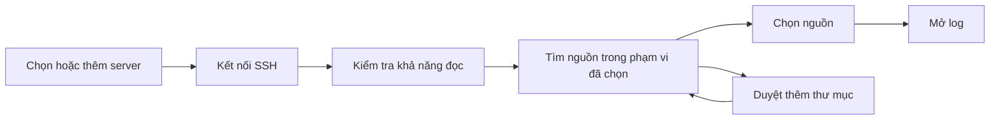

# Kết nối server và chọn log

**Trạng thái: đã triển khai luồng chính, 25/11/2026; nghiệm thu từng nền tảng đang được ghi ở [current status](../process/current-status.md).** Phạm vi1.2/1.7: form auth theo attempt, preflight capability, picker metadata và lưu lựa chọn. Client Windows dùng native OpenSSH với key/agent và các channel riêng; interactive auth chỉ trên Unix. Không coi build package là chứng nhận mọi runtime gate.


## Mục tiêu và luồng chính

User mới chỉ cần biết cách đăng nhập server. Sau kết nối, app giúp tìm nguồn, user chọn rồi mở log. User quay lại thấy server, scope đã chọn và nguồn đã nhớ; không nhập lại thông tin. Giao diện dùng vocabulary hiện có: host, connection, source, reader, scope và pin.



Không hứa tìm mọi log trên mọi server. Hiển thị phạm vi đã duyệt, nguồn chưa truy cập được và hành động mở rộng phạm vi. Không crawl toàn filesystem để làm đầy danh sách.

## 1. Kết nối: mặc định gọn, nâng cao khi cần

Cửa sổ native Connect mặc định có Saved connection, Host / SSH alias, User và Authentication; nút chính Connect. User/Port trống nghĩa là kế thừa OpenSSH config, không ghi giá trị mặc định đè lên alias. Tùy chọn nâng cao chứa Port, Jump host, IdentityAgent, environment label và dynamic-config consent. Import SSH aliases là tiện ích, không là bước bắt buộc.

| Authentication | Trải nghiệm | Dữ liệu được lưu |
| --- | --- | --- |
| SSH config / agent — mặc định | Dùng cấu hình và agent hiện có; hiển thị phương thức đang dùng khi đã xác định được | Alias và tham chiếu cấu hình; không đọc/sao chép private key |
| Private key | Chọn file trên máy đang chạy TailPro bằng native file picker | Đường dẫn file và tùy chọn định danh; không lưu nội dung key |
| Password / interactive | Hỏi thông tin trong challenge của đúng lần kết nối; hỗ trợ nhiều bước khi server yêu cầu | Không lưu password, OTP hoặc passphrase trong settings/history |

Password/interactive đã có connection-scoped askpass bridge trên client Unix; Windows từ chối phương thức này với hướng dẫn dùng key/agent. Phải có module xử lý authentication challenges theo connection attempt, có cancel/deadline và không đưa secrets vào argv, logs, IPC diagnostics hoặc frontend persistence. BatchMode không được bật cố định cho attempt cần interactive authentication; các reader tiếp tục dùng phiên đã xác thực. Không mở terminal shell chung để workaround prompt. OS credential store là một tùy chọn triển khai riêng, không mặc nhiên hứa Remember password.

Jump host kế thừa từ OpenSSH alias; structured editor chỉ cung cấp các trường xác thực rõ ràng, không nhận shell command tùy ý. Dynamic execution trong SSH config vẫn cần consent cho session. Hủy form hủy đúng attempt, không ngắt kết nối khác.

Server mới cần bước xác minh fingerprint trước khi gửi credentials. Hiển thị hostname/port/key type/fingerprint và yêu cầu đối chiếu nguồn tin cậy; không tự trust kết quả dò key. Pin đã được user xác nhận lưu vào trust store cục bộ có scope rõ, vẫn dùng strict checking. Host key thay đổi chặn connect và giải thích riêng, không chung lỗi authentication. Trust store riêng theo profile dùng strict checking; challenge yêu cầu nhập lại đúng fingerprint và xác nhận đã đối chiếu. Challenge bridge chỉ bind loopback, có token ngẫu nhiên128bit, giới hạn frame/prompt, cancel và deadline; không lưu secret sau attempt.

Connect hiển thị các bước Authenticating → Checking readers → Finding sources. Kết quả SSH authenticated tách khỏi khả năng đọc file/Docker/Journal. Cửa sổ không đóng rồi âm thầm thất bại sau khi user tưởng đã kết nối xong; lỗi giữ draft và nút Retry đúng bước.

## 2. Một cửa sổ chọn log

Giữ main window tập trung vào log. Nút + cạnh host mở cửa sổ native **Open logs**, thay cho cửa sổ chỉ nhập path. Sau lần kết nối đầu tiên, cửa sổ này xuất hiện và bắt đầu tìm metadata trong scope được hiển thị. Lần quay lại có nguồn đã nhớ thì giữ workspace, cho mở picker từ host; reconnect nền không liên tục bật cửa sổ.

Header có host, trạng thái SSH và trạng thái từng reader capability. Phần chính gồm ba lựa chọn:

| Lựa chọn | Hành vi |
| --- | --- |
| Found sources | Danh sách nguồn đã tìm được, ô tìm kiếm chỉ lọc trong kết quả, checkbox chọn nhiều và Refresh |
| Browse folders | Duyệt từng thư mục trên server, breadcrumb, Back/Up, chọn thư mục để quét thêm hoặc chọn file trực tiếp |
| Enter path | Nhập/dán absolute path bất kỳ; có completion từ directory metadata; dùng khi đã biết nguồn |

Nút chính **Open selected (N)**. Nút phụ Cancel. Không bắt user hiểu PID, unit properties hoặc config providers ở màn hình đầu. Các tùy chọn này nằm trong More locations & sources. Bộ lọc theo loại nguồn chỉ xuất hiện cho capabilities có trên host. Docker/Journal truy cập được nhưng không có kết quả vẫn hiện empty state phù hợp; unsupported capabilities được giải thích trong host details, không làm tất cả kết quả bị gắn lỗi.

File rows có tên, parent path, loại, kích thước, activity/access và nguồn manh mối. Docker rows dùng container name/Compose labels; Journal dùng unit name. Không đoán service từ filename rồi hiển thị như sự thật. Group theo metadata có provenance; thiếu metadata thì group theo thư mục. Hiện full path khi tên trùng hoặc trong tooltip/details.

Log hiện tại được ưu tiên. Archive nằm trong nhóm gập **Older files (N)**, không chọn mặc định. Tên hoặc mtime chỉ tạo archive/ranking hint; chưa có evidence thì không khẳng định file hết được ghi. File nén có metadata nhưng reader chưa hỗ trợ phải ghi Unsupported archive, không mở bằng file reader như plain text. Không mặc định chọn mọi candidate hoặc tự Start.

Nếu chưa tìm thấy: hiện **No sources found in these locations**, với Browse folders và Enter path. Nếu hết thời gian/giới hạn/quyền: hiện **Some locations were not scanned** và chi tiết theo location/provider; vẫn chọn được kết quả hợp lệ. Thiếu một preset tùy chọn không làm scan thành lỗi. Không gọi danh sách rỗng là server không có log.

## 3. Không phụ thuộc server hoặc project cố định

Frontend không chứa đường dẫn remote mặc định, tên process/framework hoặc điều kiện `if host === ...`. Nó render capabilities, locations và candidates do application trả về. DTOs được generate từ Rust.

Module host inspection xác định OS, effective user/home, Python/helper capability, công cụ có trong noninteractive SSH environment và quyền dùng provider. OS chỉ là một manh mối; một binary có trong PATH chưa chứng minh daemon/quyền đọc hoạt động. Kiểm tra bằng read-only metadata operation có giới hạn.

Các provider đang thực sự khác nhau nằm sau interface chung trong app-core: file locations, Docker metadata, systemd/Journal metadata và selected-process/config hints. Chỉ gọi provider đã xác minh có khả năng chạy; không gọi systemctl trên macOS hoặc giả sử `/proc` tồn tại. Windows hoặc host thiếu prerequisite được trả Unsupported/Unavailable rõ ràng, không hiện Connected / Ready giả.

Default locations là quy ước hệ điều hành nằm trong adapter và được kiểm tra tồn tại/quyền trước khi đề xuất. User có thể thêm, bỏ hoặc đổi scope cho mỗi host. Saved locations và locations do user chọn được ưu tiên; app không biết trước project của họ ở đâu. Thư mục bất kỳ được quét trực tiếp, không buộc phải có child tên `logs` hay framework cụ thể. Không hardcode đường dẫn của máy Mac mô phỏng vào sản phẩm.

Các tool được tìm trong environment thực của phiên SSH. Override executable, nếu bổ sung, phải là cấu hình trusted có consent/validation riêng; không biến path override thành arbitrary remote-command input. Không silently cài tool hoặc gọi shell login có side effects để tìm tool.

Symlink: kiểm tra và hiển thị cả location hiển thị lẫn resolved destination. Với quy ước hệ điều hành như `/var/log` trên Mac, adapter cung cấp resolved location như một đề xuất cụ thể. Với symlink do user duyệt, cần hành động **Use resolved location** để mở rộng scope; không follow mọi link trong cây. Start vẫn descriptor-first, NOFOLLOW và recheck identity/quyền.

Các giá trị cố định hợp lệ là budgets, protocol versions và quy ước của OS/provider có tên rõ ràng. “Không hardcode” không có nghĩa bỏ bounds hoặc thực thi arbitrary discovery script do user nhập.

## 4. Interface nhỏ, ownership rõ

Interface đề xuất, chưa phải DTOs/runtime hiện tại:

```text
inspect_host(host_handle) -> HostCapabilities
discover_sources(host_handle, scope, generation) -> DiscoverySnapshot
browse_directory(host_handle, location, cursor) -> DirectoryPage
open_sources(host_handle, selections) -> OpenResults
```

| Kết quả | Thông tin cần cho caller |
| --- | --- |
| HostCapabilities | Host/config generation, observed_at, OS/user/home nếu xác định được, provider capabilities và prerequisite/actionable issues |
| DiscoverySnapshot | Generation, searched locations, candidates, per-provider coverage/issues, bounded pagination/cap state |
| DirectoryPage | Scoped location, parent, file/directory/link metadata, resolved destination nếu cần, opaque next cursor và coverage |
| OpenResults | Mỗi selection có reader ID và starting/streaming/failed state; failure gắn đúng source |

Module connections sở hữu xác thực/trust/mux/cancel; module discovery sở hữu capability detection, provider selection, scope, dedupe và freshness. Frontend sở hữu draft, checkbox, search và trình bày. Reader giữ xác minh descriptor/checkpoint như hiện tại. Không đưa logic OS/providers vào React hoặc log-core; không tạo public plugin framework cho các provider chưa tồn tại.

Trong implementation có thể reuse discover/complete/start/stop hiện tại sau adapter; caller không cần biết cách ghép shell/path hoặc thứ tự probe từng OS. Remote operations vẫn typed, read-only và allowlisted. Interface mới cần đủ sâu để main window và picker dùng cùng policy; không copy discovery logic sang từng UI.

## 5. Scope, coverage và freshness

Kế thừa giới hạn hiện tại: session tối đa15s/1MiB/500candidates/1000entries, mỗi provider tối đa5s và concurrency2/host; directory browsing dùng page nhỏ, budget/cancellation riêng trong shared control pool. Defaults này có tên trong policy, không rải magic numbers ở UI; không mở settings cho phép vượt hard ceilings.

Quick discovery chỉ duyệt shallow trong selected locations, không đọc log body. Config parsing cần consent exact files/roots riêng. Xác định type/access/identity từ metadata, không mở FIFO/socket/device để sniff. UI phân biệt readable-at-probe với kiểm tra thực khi Start.

Coverage theo từng provider/location: Complete in scope, Partial, Denied, Unavailable, Unsupported hoặc Not selected. Không cần một `complete=false` chung chỉ vì host không có loại provider thuộc OS khác. Không gọi source là Active chỉ dựa mtime; observed growth phải giữ window/evidence như contract hiện tại.

Cancel, host switch, SSH/config/trust change invalidate generation. Kết quả cũ không được ghép vào host mới hoặc ghi đè scan mới. Cache metadata có TTL/byte cap, không pin raw logs. Folder browsing dùng opaque cursor có TTL/generation; nếu thư mục đổi trong lúc paging, báo stale/refresh, không hứa snapshot atomic của remote filesystem.

## 6. Mở nhiều nguồn và xử lý lỗi

Open selected hiển thị số slot còn lại theo runtime budgets, không hardcode capacity ở button. Kiểm tra dedupe theo host + source identity và các readers đang mở trước khi tạo reader mới. Chọn nguồn đang mở thì focus tab, không mở thêm reader.

Reader state cần được quan sát sau Start: Starting → Streaming hoặc Needs action/Failed. **Chỉ streaming mới được báo Opened successfully.** Nếu một số nguồn thất bại, giữ thành công và báo lỗi theo row; picker cho Retry failed hoặc tiếp tục với nguồn đã mở. Retry không nhân bản readers. Close picker không Stop readers đã được user mở; Cancel discovery hủy owned probes.

Một nguồn mở tab đơn. Nhiều nguồn mở các tab và một Combined selection; user đổi tab không Stop. Header/source health giữ coverage ngoài filter. Không tự giải nén/chạy command từ filename hoặc nội dung log.

## 7. Lưu để không nhập lại

| Dữ liệu | Chính sách |
| --- | --- |
| Connection profile | Host/alias, user/port override, auth method + references, jump reference, label; stable ID |
| Saved locations | Directories/provider options user chọn, bound host/remote identity; bounded/versioned |
| Remembered sources | Source specs/labels hợp lệ đã mở; revalidate access/identity ở lần sau |
| Workspace | Host đang chọn, tab order và combined selection theo saved source identities; không persist ephemeral reader IDs |
| Secrets / consent | Password/OTP/passphrase không lưu settings; dynamic/config/external-model consent không tự renew |
| Log history | RAM semantics hiện tại giữ nguyên; restore tab không được gọi là phục hồi toàn bộ log trước khi thoát |

Sau restart, server có trạng thái Saved / Disconnected, không giả Connected. Connect một lần dùng profile đã lưu. Nếu user bật tùy chọn Restore previous readers thì app revalidate nguồn trước khi Start; mặc định giữ nhớ nguồn nhưng không tự đọc. Identity/config/trust đổi phải kiểm tra lại preferences/sources, không silently reuse grants.

New connection dùng lại stable profile ID khi user chọn saved profile. Không tự merge alias với IP hoặc hai users khác nhau chỉ vì cùng hostname; endpoint equivalence cần evidence hoặc hành động user. Có Edit/Forget rõ ràng; Forget không tự xóa private key hoặc trust của server khác.

## 8. Phản hồi lỗi và accessibility

Lỗi có code/cause/action: DNS/network, authentication rejected, key unavailable, unknown/changed host key, challenge cancelled, SSH authenticated but helper unavailable, provider denied và directory unreadable. Không gộp tất cả thành Verify SSH config. UI giữ thông tin không nhạy cảm để Retry; details redacted.

Keyboard: Tab theo thứ tự, Space chọn checkbox, Enter mở selection, Escape đóng picker/hủy stage hiện tại, focus về đúng nút host. Search có accessible label, scan status dùng polite announcements, không announce mỗi log. Layout tối thiểu800×600, picker responsive; full paths wrap/tooltip và container có scroll riêng, không đẩy primary action ra ngoài viewport. Dùng tokens/fonts/primitives hiện tại; không thêm dashboard metrics hoặc các bước xác nhận cho thao tác đọc đã được user chọn.

## 9. Thứ tự triển khai và nghiệm thu

1. **1.7 / capability + discovery:** host inspection, typed results, directory browsing, per-provider coverage và scopes có thể lưu. Chạy Linux và Mac thật với roots không có cấu trúc framework cố định.
2. **1.7 / picker:** thay Add log path bằng Open logs, nối Found sources/Browse/Enter path và multi-select vào reader hiện tại; native lifecycle và ACK/results theo source.
3. **1.2 / connection UX:** method selection, key picker, actionable stages/errors; first-connect fingerprint và interactive auth cần module/challenge/trust implementation riêng, không coi đổi form là đã hỗ trợ.
4. **1.2/1.7 / restore:** preferences, remembered sources và workspace bằng stable identities, migration settings cũ, edit/forget.

Manual acceptance theo quy định repo: Linux/Mac; custom log directory không tên logs; space/quote/Unicode; missing Python/tool, tool ngoài noninteractive PATH, daemon absent/permission denied; symlink resolved scope; nhiều archive và file nén; cancel/switch/stale result; key/agent/alias/jump và secret-free auth errors; batch open có partial failure; restart giữ profile/scopes nhưng không giả connected hoặc leak grants. Build/lint/typecheck/contracts cần đạt; không tạo automated tests nếu user chưa yêu cầu.

Thiết kế không tự đóng các runtime/release gates hiện còn PARTIAL. Hình minh họa: [connection-and-source-picker.svg](../assets/connection-and-source-picker.svg); tên/rows trong hình là ví dụ thiết kế, không dữ liệu runtime.

## Phạm vi phát hành0.1.0

Picker hiện cung cấp Found sources/Browse folders/Enter path, Up/current path, paging64entries, cache30s gắn host identity và kiểm tra revision trước trang kế tiếp; scan tối đa16locations, directory metadata tối đa1000entries/256KiB. Phần config/PID nâng cao vẫn có backend opt-in, chưa đưa thêm controls vào picker gọn này. File nén bị chặn trước khi Start. Chỉ lưu profile sau authentication/preflight thành công; Test không thay active connection. Open selected báo kết quả từng source; đóng picker hủy phần chưa mở, giữ reader đã chạy. Reader tối đa8; lịch sử source tối đa100/host,800global. Khôi phục chỉ sau user reconnect và opt-in, có kiểm tra remote identity.

Main HOSTS chỉ giữ một nút + cho Open logs; không thêm nút ⋯ hay Connect cạnh host. Bấm host đã lưu để mở form reconnect. Connections form quản lý bản nháp/edit; danh sách Connections có Forget. Chọn cột/time/status không thêm controls khác vào hàng viewer.
